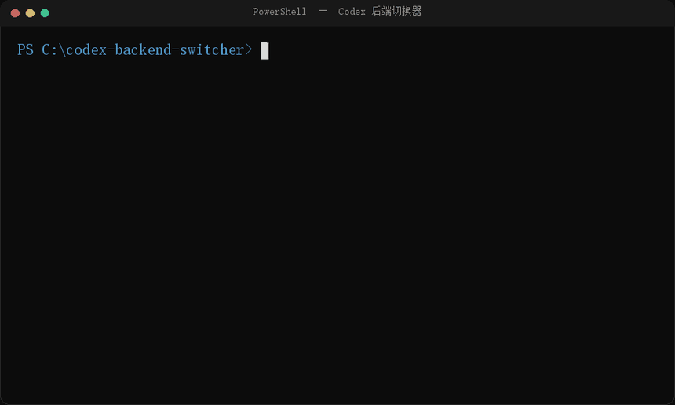

# Codex 后端切换器

**codex-backend-switcher**

[](https://github.com/Afterflowsea/codex-backend-switcher/releases)
[](LICENSE)


在 **ChatGPT 官方账号** 和 **多个第三方中转站** 之间，一键切换 Codex 的后端。

> One-click backend switcher for Codex on Windows — jump between the official ChatGPT
> account and any number of third-party API relays, without hand-editing `config.toml`.

> 解决的问题：Codex 只有一个凭据槽位（`auth.json`），账号登录和中转 key 登录互斥。
> 手动改 `config.toml` + 换 key + 重启 App 很麻烦，还容易改坏。
> 这个工具把「校验 → 关闭 App → 改配置 → 恢复凭据 → 重开 App」做成一次操作。



---

## 特性

- **切换前先校验**：请求不通、key 无效、分组没有该模型，一律不写盘，当前配置保持原样
- **成对切换**：`config.toml`、`auth.json`、代理环境变量、站点状态一起换，不会出现"配置指向 A、key 是 B"
- **切回账号不用重新登录**：首次账号登录后自动备份 tokens，之后直接还原
- **记住每个站点的模型**：在 Codex 界面里换过模型，切走时会被记录，切回来自动恢复
- **按站点配代理**：只给需要翻墙的站点设 `HTTPS_PROXY`，不污染其它站点
- **失败时说人话**：把厂商的原始报错原样打出来（例如 `not supported ... in this group` 说明是 key 分组问题，不是余额）
- **不改动其它配置**：只增删和 provider 相关的几行，项目信任、主题、MCP、插件都保留

---

## 快速开始

### 1. 安装

```powershell
# 在本仓库根目录执行
powershell -ExecutionPolicy Bypass -File .\bin\install.ps1
```

安装会做三件事：

- 把程序复制到 `%LOCALAPPDATA%\CodexSwitcher`
- 在 `%USERPROFILE%\.codex\.switch` 初始化状态目录，并从 `config/providers.example.json` 生成 `providers.json`
- 在桌面创建「Codex 切换」快捷方式（带自定义图标）

### 2. 配置站点

编辑 `%USERPROFILE%\.codex\.switch\providers.json`，把示例里的 `base_url` / `model` / `proxy` 换成你自己的。

### 3. 使用

双击桌面图标，输入序号即可。也可以用命令行：

```powershell
$sw = "$env:LOCALAPPDATA\CodexSwitcher\src\CodexSwitcher.ps1"

powershell -File $sw list              # 列出站点
powershell -File $sw status            # 当前站点 / 登录方式 / 代理 / 模型
powershell -File $sw apimart           # 切到 apimart（会关闭并重开 Codex）
powershell -File $sw account           # 切回 ChatGPT 账号
```

---

## 目录结构

```
codex-switcher/
├─ src/
│  ├─ CodexSwitcher.ps1          入口：参数解析 + 切换流程编排
│  └─ lib/
│     ├─ Common.ps1              路径 / JSON / 彩色输出 / 等宽对齐
│     ├─ Providers.ps1           站点清单、当前状态、key 读写、模型记忆
│     ├─ CodexConfig.ps1         改写 config.toml（增删 provider 块）
│     ├─ Auth.ps1                管理 auth.json（apikey / chatgpt 两种）
│     ├─ Network.ps1             连通性校验、模型列表、真实对话探测
│     ├─ Proxy.ps1               按站点设置 / 清除代理环境变量
│     └─ App.ps1                 定位/关闭/启动 Codex，拉起登录
├─ bin/
│  ├─ switcher.bat               菜单入口（双击的就是它）
│  ├─ menu.ps1                   交互菜单，站点从 providers.json 动态生成
│  ├─ install.ps1                安装：复制程序 + 初始化状态 + 建快捷方式
│  └─ uninstall.ps1              卸载
├─ assets/icon/                  图标（含生成脚本）
├─ config/providers.example.json 站点配置示例
├─ docs/                         详细文档
└─ tests/smoke.ps1               离线冒烟测试
```

### 功能 → 文件对照

| 功能 | 位置 |
|---|---|
| 切换流程编排 | `src/CodexSwitcher.ps1` |
| 改写 `config.toml` | `src/lib/CodexConfig.ps1` |
| 登录凭据切换 | `src/lib/Auth.ps1` |
| 切换前校验 | `src/lib/Network.ps1` |
| 站点与 key 管理 | `src/lib/Providers.ps1` |
| 代理环境变量 | `src/lib/Proxy.ps1` |
| 关闭 / 重开 Codex | `src/lib/App.ps1` |
| 交互菜单 | `bin/menu.ps1` |
| 安装 / 卸载 | `bin/install.ps1` / `bin/uninstall.ps1` |

---

## 依赖

| 依赖 | 版本 | 说明 |
|---|---|---|
| Windows | 10 / 11 | 用到 `%LOCALAPPDATA%`、WScript.Shell 建快捷方式 |
| PowerShell | 5.1（系统自带） | 不需要装 PowerShell 7 |
| Codex 桌面端 | 任意近期版本 | 需要 `codex.exe`，用于 `codex app` 启动和 `codex login` |
| Python + Pillow | 3.9+ / 10+ | **仅**重新生成图标时需要，运行本工具不需要 |

没有 npm、没有编译步骤，克隆下来就能跑。

---

## 它是怎么工作的

一次切换分五步：

1. **校验**：用 key 请求 `{base_url}/models`，再发一次最小 `/responses` 请求
2. **关闭 Codex**：App 退出时会把内存里的设置写回 `config.toml`，必须先关
3. **写文件**：`config.toml` 增删 provider 块、`auth.json` 换成对应凭据、设置代理变量
4. **恢复登录态**：账号模式还原备份的 tokens；没有备份才拉起 device code 登录
5. **重开 Codex**：`codex app`

细节见 [docs/how-it-works.md](docs/how-it-works.md)。

---

## 配置

`providers.json` 里每个站点的字段：

| 字段 | 必填 | 说明 |
|---|---|---|
| `id` | ✅ | 唯一标识，同时作为 `model_provider` 的名字 |
| `name` | ✅ | 菜单里显示的名字 |
| `kind` | ✅ | `account`（官方账号）或 `relay`（中转） |
| `base_url` | relay 必填 | 例：`https://api.example.com/v1`；是否带 `/v1` 看服务商 |
| `model` | | 该站点默认模型；留空则自动从模型列表挑选 |
| `proxy` | | 需要翻墙时填 `http://127.0.0.1:7890`，直连留空 |
| `extra` | | 附加到这个站点的根级配置项，例如 `web_search`、`model_context_window` |
| `note` | | 备注，不参与逻辑 |

完整说明见 [docs/configuration.md](docs/configuration.md)。

---

## 安全说明

- API key 以明文保存在 `%USERPROFILE%\.codex\.switch\keys\<id>.key`
  权限与 Codex 自己的 `auth.json` 同级。不想留明文就删掉对应文件，下次切换会重新询问。
- 首次输入 key 时不回显，只在本机落地。
- 仓库里**不含**任何真实 key：`.gitignore` 已排除 `keys/`、`auth*.json`、`providers.json`、`*.key`。
- 本工具会修改 `~/.codex/config.toml` 与 `~/.codex/auth.json`。建议定期备份，或先用 `-NoClose -NoLaunch` 试跑。

---

## 常见问题

见 [docs/troubleshooting.md](docs/troubleshooting.md)，收录了：

- `401 invalid_api_key`
- `Model "xxx" is not supported by any configured account in this group`
- 直连超时、代理不生效
- 切换后 Codex 里模型不对 / 登录掉线
- 图标不刷新

---

## 开发

```powershell
# 离线冒烟测试（不联网、不动真实配置）
powershell -ExecutionPolicy Bypass -File .\tests\smoke.ps1

# 只改文件、不动进程，方便调试
powershell -File .\src\CodexSwitcher.ps1 <站点id> -NoClose -NoLaunch

# 用自定义配置目录，完全隔离
powershell -File .\src\CodexSwitcher.ps1 list -Root C:\temp\fake-codex
```

所有 `.ps1` 文件必须以 **UTF-8 with BOM** 保存，否则 PowerShell 5.1 会把中文读成乱码。

---

## 关键词 / Keywords

方便检索，也方便你判断这个项目是不是你要的：

`codex 切换器` · `codex 后端切换` · `codex 中转站` · `codex 多后端` · `codex 账号切换` ·
`codex 换 api` · `codex apikey` · `codex provider switcher` · `codex backend switch` ·
`codex relay switcher` · `chatgpt account vs api key` · `codex-cli` · `powershell` · `windows`

---

## 许可

[MIT](LICENSE)

